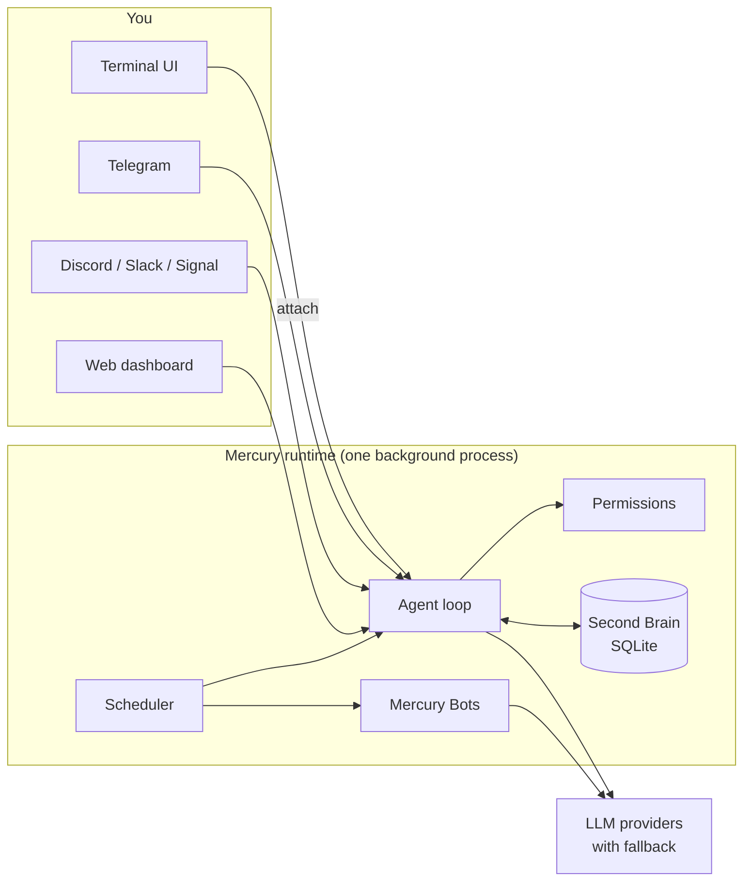

<p align="center">
  <picture>
    <source media="(prefers-color-scheme: dark)" srcset="https://raw.githubusercontent.com/cosmicstack-labs/mercury-agent/main/docs/img/readme-hero-dark.png">
    <source media="(prefers-color-scheme: light)" srcset="https://raw.githubusercontent.com/cosmicstack-labs/mercury-agent/main/docs/img/readme-hero-light.png">
    
  </picture>
</p>

<h3 align="center">あなたのマシンに住む、魂を持った AI エージェント。<br/>行動する前に確認し、大切なことを覚え、あなたが離れても働き続けます。</h3>

<p align="center">
  <a href="https://www.npmjs.com/package/@cosmicstack/mercury-agent"></a>
  <a href="https://github.com/cosmicstack-labs/mercury-agent/blob/main/.github/badges/downloads-breakdown.json"></a>
  <a href="https://github.com/cosmicstack-labs/mercury-agent/actions/workflows/ci.yml"></a>
  <a href="https://github.com/cosmicstack-labs/mercury-agent/stargazers"></a>
  <a href="https://nodejs.org/"></a>
  <a href="LICENSE"></a>
  <a href="https://discord.gg/5emMpMJy5J"></a>
</p>

<p align="center">
  <a href="https://trendshift.io/repositories/30943?utm_source=trendshift-badge&amp;utm_medium=badge&amp;utm_campaign=badge-trendshift-30943" target="_blank" rel="noopener noreferrer"></a>
</p>

<p align="center">
  <a href="https://mercuryagent.sh">ウェブサイト</a> ·
  <a href="https://mercuryagent.sh/docs">ドキュメント</a> ·
  <a href="#クイックスタート">クイックスタート</a> ·
  <a href="CHANGELOG.md">変更履歴</a> ·
  <a href="https://discord.gg/5emMpMJy5J">Discord</a>
</p>

<p align="center">
  <a href="README.md">English</a> ·
  <a href="README.zh-CN.md">简体中文</a> ·
  日本語
</p>

---

**多くの AI エージェントは翌朝にはあなたのことを忘れ、モデルが決めたことを何でも実行し、ノートパソコンを閉じた瞬間に止まってしまいます。Mercury は違います。**

Mercury はオープンソースのエージェントです。人格はあなた自身が書き、記憶はあなたのディスクに保存され、モデルとあなたのマシンの間には権限システムが入ります。ターミナル、Telegram、Discord、Slack、Signal のどこからメッセージを送っても、同じ記憶を持つ同じエージェントにつながります。それはあなたが所有する 1 つのバックグラウンドプロセスとして動作します。

ファイルの読み書き、コマンドの実行、git と GitHub を通じたコードの出荷、Web での調査、スケジュール管理をこなします。これらのアクションはすべてあなたが設定したルールに照らしてチェックされ、すべてのターンは 1 日のトークン予算内に収まります。

さらに、その先へ:

- **Mercury Code** は、リポジトリ内で慎重なペアプログラマーとして働きます。テストが通るまで「完了」とは言いません。
- **Mercury Bots** はチームを与えます。常駐するスペシャリストたちが自分のスケジュールで調査・執筆・出荷を行い、完成したファイルを開けるフォルダに、あるいは Telegram のチャットに直接届けます。

インストールは 1 行。どこからでも話しかけられます。明日もそこにいて、ちゃんと覚えています。

## 概要

| | |
|---|---|
| **インストール** | Node.js 不要のワンライナーインストーラー、または Node.js 22 以上で `npm i -g @cosmicstack/mercury-agent` |
| **動作環境** | macOS、Linux、Windows、Termux 経由の Android |
| **話しかけられる場所** | ターミナル UI、Telegram、Discord、Slack、Signal、ローカル Web ダッシュボード |
| **モデル** | DeepSeek、OpenAI、Anthropic、Grok、Ollama(クラウドとローカル)、LM Studio、任意の OpenAI 互換エンドポイント、Mercury Cloud など。自動フォールバック付き |
| **安全性** | シェルのブロックリスト、フォルダごとの読み書きスコープ、承認プロンプト、SSRF 対策済みのフェッチ、ログ内のシークレット秘匿 |
| **記憶** | Second Brain: 型付きで重複排除された事実を全文検索付きの SQLite に保存。すべてあなたのディスク上 |
| **ツール** | 約 50 個を内蔵(ファイル、シェル、git、GitHub、Web、スケジューラー、記憶、サブエージェント)+ インストール可能なスキル |
| **常時稼働** | クラッシュ復旧機能付きのバックグラウンドデーモンと、全 OS 対応のログインサービス |
| **ライセンス** | MIT |

## なぜ Mercury なのか

ほとんどのエージェントは、ファイルを読み、コマンドを実行し、ページを取得できます。違いはそれらのアクションの周辺で何が起きるかにあり、Mercury が力を注いでいるのはまさにそこです。

**実行する前に確認します。** ファイルアクセスはフォルダ単位でスコープが設定され、シェルコマンドはブロックリストと承認ステップを通過し、外向きのリクエストはプライベートアドレス範囲に対してチェックされます。毎回確認させるか自由に実行させるかはセッションごとに選べます。また、共有の Telegram や Discord チャンネルのメンバーが自分の権限を勝手に広げることはできません。

**言われなくてもあなたを覚えています。** 各会話の後、Mercury は永続的な事実(好み、目標、プロジェクト、決定事項)をいくつか信頼度スコア付きで抽出し、既存の知識との矛盾を解消し、次の回答の前に関連するものを思い出します。すべては `~/.mercury` 配下の SQLite ファイルに保存され、`/memory` で確認・一時停止・消去ができます。

**予算を守ります。** 1 日のトークン予算がすべてのターンで適用されます。使用量が増えると Token Saver モードがコンテキストを削減し、定型的な作業をより安価なモデルに回すこともできます。`/budget` で現状を確認できます。

**スクリプトの寄せ集めではなく、1 つのランタイムです。** 1 つのバックグラウンドプロセスがチャンネル、ボット、Web ダッシュボードを管理します。ターミナルで `mercury` を実行するとそのプロセスに即座にアタッチされるため、ターミナルを閉じても実行中のタスクやボットが止まることはありません。

**慎重なエンジニアのようにコードを書きます。** Mercury Code は 1 つの流れで計画と構築を行い、ライブのチェックリストを表示し、大きな変更の前に一度だけ確認し、ビルド・テスト・型チェックが実際に通った後にのみ成功を報告します。

**あなたが離れている間も働きます。** Mercury Bots は、独自のペルソナ、モデル、記憶、権限、1 日の予算を持つ常駐スペシャリストです。スケジュールに従って動き、互いに仕事を引き継ぎ、完成したファイルを `~/Documents/Mercury/<Bot name>/` に届けます。フリート全体を Telegram からボタンで管理できます。

**人格はあなたのものです。** Mercury のキャラクターは、編集可能なプレーンな Markdown ファイル(`soul.md`、`persona.md`、`taste.md`、`heartbeat.md`)で定義されています。

## クイックスタート

**1. インストール。** インストーラーは OS と CPU に合ったスタンドアロンバイナリをダウンロードし、チェックサムを検証します。Node.js は不要です。

```bash
# macOS / Linux
curl -fsSL https://mercuryagent.sh/install.sh | sh
```

```powershell
# Windows (PowerShell)
irm https://mercuryagent.sh/install.ps1 | iex
```

npm を使いたい場合は、**Node.js 22 以上**が必要です。

```bash
npm i -g @cosmicstack/mercury-agent
```

**2. 起動。**

```bash
mercury
```

初回起動時には短いセットアップウィザードが始まります: あなたの名前、エージェントの名前、Mercury Cloud か自分の API キーか、そして Telegram などのオプションのチャンネル。その後 Mercury はバックグラウンドサービスを起動し、ターミナル UI を開きます。

**3. 毎日使う。**

```bash
mercury            # チャットを開く(実行中の Mercury にアタッチ)
mercury code .     # 現在のリポジトリで Mercury Code を開く
mercury doctor     # プロバイダー、キー、チャンネルを変更。即座に反映
mercury status     # 実行中のものを確認
```

アップグレードは 1 コマンド: `mercury upgrade`。すでに最新版の場合は何もしません。

## 仕組み



ランタイムはログインサービス(macOS では LaunchAgent、Linux では systemd、Windows ではタスクスケジューラー)として動作し、クラッシュ後は自動で再起動します。すべてのチャンネルが同じエージェント、同じ権限、同じ記憶とやり取りします。ターミナルはクライアントです: `mercury` はランタイムにアタッチし、`mercury code` はその横でコーディングセッションを開きます。

## 機能

### チャンネル

| チャンネル | アクセスモデル | 主な特徴 |
|---|---|---|
| **Terminal** | 単一ユーザー | ライブストリーミング付きのフルスクリーン UI、コマンドピッカー(`/menu`)、承認プロンプト、バックグラウンドタスク |
| **Telegram** | 管理者とメンバー、ペアリングコード | ストリーミング返信、ファイル配信、承認とボット制御用のインラインボタン |
| **Discord** | 管理者ロール、サーバーとチャンネルのスコープ | スラッシュコマンド、ストリーミング編集、DM とチャンネル |
| **Slack** | 管理者とメンバー | Socket Mode(公開エンドポイント不要)、ストリーミング編集、`/mercury` コマンド |
| **Signal** | ペアリングコード | `signal-cli` によるエンドツーエンド暗号化、グループと DM |
| **Web** | ローカルログイン | チャット、カンバン、ボットコックピット、記憶エクスプローラー、プロバイダーとスキル |

複数のチャンネルが設定されている場合、通知は Signal、Telegram、Discord、Slack、ターミナルの順で最初に利用可能なものに送られます。

### Mercury Code

リポジトリ内で動作するフルスクリーンのコーディング環境です。

```bash
mercury code [dir]   # シェルから
/code                # 実行中のチャットから
```

- **AUTO モード:** 1 回のパスで計画と構築を行い、大きな変更やリスクのある変更の前に一度だけ確認します。
- **検証済みの完了:** ビルド、テスト、型チェックが実行されて通過した場合にのみ、タスクは完了となります。そうでない場合は停止し、ブロッカーを明示します。
- **ライブプラン:** 各ステップが保留中・実行中・完了として表示されます。
- **バックグラウンド作業:** `/code agent <task>` で作業を続けながらサブエージェントにタスクを渡せます。
- **ワークスペースビュー:** `/ws` で閲覧、ステージ、コミット、取り消し。`/code diff` で色付きの差分を表示。

### Mercury Bots

メインエージェントをブロックせずに並行して動作する、常駐型のスペシャリストエージェントです。

- **オンボーディング:** ターミナル、Telegram、Web ダッシュボードから `/bots create` で作成。ペルソナ、権限ティア、ソロかフリートか、1 日の予算を設定します。
- **フリート:** リーダーボットが型付きのタスクをクルーに委任し、`bot.yaml` で定義されたパイプラインを実行し、作業完了時に 1 つのサマリーを受け取ります。
- **成果物:** 完成したファイルは `~/Documents/Mercury/<Bot name>/` に、作業中のものは `work/` 配下に置かれます。Telegram では結果が添付ファイルとして届きます。
- **ガバナンス:** ターンごとの制限、ボットごと・フリートごとの 1 日のトークン予算、ボットが実際に行ったことに基づく成果判定、トークンを浪費せずクールダウンするルーチン。
- **運用:** Telegram では Stop・Start・Run ボタン付きの `/bots` 一覧。`/bots cost`、`/bots show`、`/bots doctor`、`/bots stop all`。

設計ノート: [BOTS-ARCHITECTURE.md](BOTS-ARCHITECTURE.md)。

### Second Brain

- **10 種類の記憶タイプ:** identity(アイデンティティ)、preference(好み)、goal(目標)、project(プロジェクト)、habit(習慣)、decision(決定)、constraint(制約)、relationship(関係)、episode(エピソード)、reflection(内省)。
- **自動抽出:** 会話ごとに最大 3 つの事実を、信頼度・重要度・永続性スコア付きで抽出します。
- **想起:** 各回答の前に、固定の予算内で最も関連性の高い記憶を呼び出します。
- **統合:** 1 時間ごとにプロフィールとアクティブ状態のサマリーへ統合し、古い事実や信頼度の低い事実は徐々に消えていきます。
- **ローカルのみ:** `~/.mercury/memory/second-brain/second-brain.db`(FTS5 付き SQLite)。`memory.secondBrain.enabled: false` で無効化できます。

### 権限と安全性

- **シェル:** 上書きできないブロックリスト(`sudo`、`rm -rf /` とその亜種)に加え、許可スコープ外のすべての操作に承認が必要です。
- **ファイル:** フォルダごと、チャンネルごと、ロールごとの読み書きスコープ。
- **ネットワーク:** `fetch_url` はプライベートアドレス範囲をブロックし、レスポンスサイズに上限を設けます。
- **モード:** セッションごとに *Ask Me* か *Allow All* を選択でき、`/permissions` で変更できます。
- **シークレット:** API キーは `~/.mercury/.env` に保存され、ログでは秘匿され、ダッシュボードのパスワードは初回起動時にランダムに生成されます。

脆弱性は [SECURITY.md](SECURITY.md) から報告してください。

### スキル

[Agent Skills](https://agentskills.io) 仕様に基づくコミュニティスキルを [skills.mercuryagent.sh](https://skills.mercuryagent.sh) からインストールできます。

```bash
mercury skills search prompt
mercury skills view ai-ml/prompt-engineering    # インストール前に内容を確認
mercury skills install ai-ml/prompt-engineering
```

スキルはコミュニティによる提供で監査されていないため、事前に内容を確認してください。Web ダッシュボードから、または管理者であれば Telegram からもインストールできます。

### Web ダッシュボード、カンバン、スケジューラー

- **ダッシュボード:** `http://127.0.0.1:6174`(localhost にバインド)。チャット、ボットコックピット、記憶エクスプローラー、プロバイダー、スキル、権限、スケジュール、使用量。
- **カンバンボード:** Mercury が依存関係の順にカードを 1 枚ずつ処理し、カードごとのトークン使用量を追跡します。
- **スケジューラー:** `schedule_task` による cron スケジュールと単発の遅延実行。結果は作成元のチャンネルに返されます。

### プロバイダー

Mercury はまずデフォルトのプロバイダーを試し、失敗した場合は他のプロバイダーにフォールバックします。キーが拒否されたプロバイダーはキーを修正するまでスキップされ、`mercury doctor` は有効になり得ないキーについて警告します。

<details>
<summary><b>対応プロバイダーとデフォルトモデル</b></summary>

| プロバイダー | デフォルトモデル | キー |
|---|---|---|
| Mercury Cloud | `mercury-mini` | `mercury cloud connect` でペアリング |
| DeepSeek | `deepseek-chat` | `DEEPSEEK_API_KEY` |
| OpenAI | `gpt-4o-mini` | `OPENAI_API_KEY` |
| Anthropic | `claude-sonnet-4` | `ANTHROPIC_API_KEY` |
| Grok (xAI) | `grok-4` | `GROK_API_KEY` |
| Atlas Cloud | `qwen/qwen3.5-flash` | `ATLASCLOUD_API_KEY` |
| AI/ML API | `anthropic/claude-sonnet-4.6` | `AIMLAPI_API_KEY` |
| MiMo (Xiaomi) | `mimo-v2.5-pro` | `MIMO_API_KEY` |
| Ollama Cloud | `gpt-oss:120b` | `OLLAMA_CLOUD_API_KEY` |
| Ollama Local | ローカルモデル | 不要 |
| LM Studio | ローカルモデル | 不要 |
| OpenAI 互換 | 任意 | `OPENAI_COMPAT_API_KEY` と `OPENAI_COMPAT_BASE_URL` |

LiteLLM と GitHub Copilot のエンドポイントも `mercury doctor` から利用できます。

</details>

## リファレンス

<details>
<summary><b>CLI コマンド</b></summary>

| コマンド | 内容 |
|---|---|
| `mercury` | Mercury を起動、またはすでに実行中ならアタッチ |
| `mercury up` | ログインサービスをインストールし、Mercury が実行中であることを保証 |
| `mercury attach` | このターミナルを実行中のランタイムにアタッチ |
| `mercury code [dir]` | ディレクトリで Mercury Code を開く |
| `mercury start [-d]` / `stop` / `restart` | ランタイムを制御 |
| `mercury status` / `logs` | ステータスと最近のログを表示 |
| `mercury doctor [--platform]` | 再設定。`--platform` で互換性レポートを出力 |
| `mercury setup` | セットアップウィザードを再実行 |
| `mercury upgrade [--force]` | 最新版にアップグレード |
| `mercury telegram` / `discord` / `slack` / `signal` | チャンネルのアクセスを管理 |
| `mercury bots` | `doctor`、`list`、`storage` |
| `mercury skills` | `search`、`browse`、`view`、`install`、`remove`、`update`、`doctor` |
| `mercury cloud` | `connect`、`disconnect`、`status`、`login`、`models` |
| `mercury service` | `install`、`uninstall`、`status` |
| `mercury web-reset-password` | ダッシュボードのパスワードをリセット |
| `mercury uninstall [--purge-data]` | Mercury を削除。オプションで全データも削除 |

</details>

<details>
<summary><b>チャット内コマンド</b></summary>

これらはローカルで実行され、トークンを消費しません。`/help` ですべて表示されます。

| コマンド | 内容 |
|---|---|
| `/menu` | コマンドピッカー |
| `/status`、`/trace [id]` | 設定と使用量。ターンで何が行われたか |
| `/new`、`/sessions` | 新しい会話。セッションの一覧と切り替え |
| `/models` | プロバイダーを一覧表示。`/models use <provider>` で切り替え |
| `/budget`、`/saver` | トークン予算。Token Saver モード |
| `/permissions` | Ask Me と Allow All を切り替え |
| `/memory` | Second Brain の確認と管理 |
| `/code`、`/ws` | Mercury Code。ワークスペースビュー |
| `/research [topic]` | ディープリサーチモード |
| `/bg`、`/agents` | バックグラウンドタスク。サブエージェント |
| `/bots`、`/bot <id> <task>` | ボットフリート。ボットにタスクを渡す |
| `/tools`、`/skills` | 読み込まれたツール。インストール済みスキル |
| `/cloud`、`/spotify` | Mercury Cloud のモデル。Spotify の操作 |
| `/stop`、`/halt`、`/reset` | 作業を停止、すべてを停止、コンテキストをリセット |
| `/whatsnew` | このバージョンの変更点 |

</details>

<details>
<summary><b>内蔵ツール</b></summary>

| 分野 | ツール |
|---|---|
| ファイル | `read_file`、`write_file`、`create_file`、`edit_file`、`list_dir`、`delete_file`、`send_file`、`approve_scope` |
| シェル | `run_command`、`cd`、`approve_command` |
| Git | `git_status`、`git_diff`、`git_log`、`git_add`、`git_commit`、`git_push` |
| GitHub | `create_pr`、`review_pr`、`list_issues`、`create_issue`、`github_api`(`GITHUB_TOKEN` 設定時) |
| Web | `fetch_url` |
| スキル | `install_skill`、`list_skills`、`use_skill` |
| スケジューラー | `schedule_task`、`list_scheduled_tasks`、`cancel_scheduled_task` |
| 記憶 | `save_memory`、`search_memory` |
| エージェント | `delegate_task`、`list_agents`、`stop_agent`、`dispatch_bot` |
| インタラクション | `ask_user`、`update_plan`、`send_message`、`budget_status` |
| Spotify | 検索、再生、キュー、デバイス、プレイリストなど(接続時) |

</details>

<details>
<summary><b>ファイルと設定</b></summary>

Mercury が保存するものはすべて `~/.mercury/` にあり、プロジェクト内には決して置かれません。

| パス | 内容 |
|---|---|
| `mercury.yaml` | メイン設定: プロバイダー、チャンネル、予算、Web |
| `.env` | API キーとトークン |
| `soul/*.md` | 人格: soul、persona、taste、heartbeat |
| `permissions.yaml` | スコープと承認ルール |
| `skills/` | インストール済みスキル |
| `schedules.yaml` | スケジュールされたタスク |
| `sessions/` | 会話 |
| `memory/second-brain/` | Second Brain データベース |
| `bots/` | ボットのペルソナ、ジャーナル、キュー、権限 |
| `boards.db` | カンバンボード |
| `daemon.log`、`daemon.pid` | ランタイムのログとプロセス ID |

</details>

## ソースからビルド

必要なもの: **Node.js 22 以上**。スタンドアロンバイナリを作成する場合のみ [Bun](https://bun.sh) 1.3 以上。

```bash
git clone https://github.com/cosmicstack-labs/mercury-agent.git
cd mercury-agent
npm install
npm run build        # dist/ と Web UI
npm test             # vitest
node dist/index.js   # ビルドを実行
```

スタンドアロンバイナリ:

```bash
npm run build:bin       # このマシン向けのみ(release/smoke/)
npm run build:bin:all   # 全ターゲット: macOS arm64/x64、Linux x64/arm64(+ no-AVX2 ビルド)、Windows x64(+ no-AVX2 ビルド)
```

リリースバイナリは署名されていません。macOS で独自ビルドを配布する場合は、`codesign` で署名し公証(notarize)を行ってください。

## ドキュメント

| リソース | |
|---|---|
| [mercuryagent.sh/docs](https://mercuryagent.sh/docs) | ガイド、プラットフォーム設定、チャンネル設定、リファレンス |
| [ARCHITECTURE.ja.md](ARCHITECTURE.ja.md) | ランタイムの構成 |
| [BOTS-ARCHITECTURE.md](BOTS-ARCHITECTURE.md) | ボット、フリート、そのガバナンス |
| [DECISIONS.md](DECISIONS.md) | アーキテクチャ決定記録 |
| [CHANGELOG.md](CHANGELOG.md) | すべてのリリース |
| [SECURITY.md](SECURITY.md) | 脆弱性の報告 |

## コントリビューション

バグ報告から新しいツールまで、コントリビューションを歓迎します。Mercury は何日も無人で動き続けるエージェントなので、一般的なライブラリ以上に重要ないくつかの原則があります:

- **すべての外部アクションは権限を通す。** ファイル、シェル、ネットワーク、git が権限システムや SSRF ガードを迂回することは決してありません。
- **人間もターミナルもいない前提で考える。** ツールはどのチャンネルでも同じように動作する必要があります。
- **トークンは慎重に使う。** ツールの出力は小さく保ってください。それはモデルのコンテキストに入ります。
- **穏やかに失敗する。** プロバイダーの障害やファイルの欠落は、クラッシュではなく正直なメッセージを生むべきです。
- **関数だけでなくループをテストする。** 単体で動くツールでも、複数ステップのターンを停滞させることがあります。

はじめ方:

1. リポジトリをフォークしてクローンし、`npm install` を実行します。
2. テストと一緒に変更を加えます。
3. `npm run lint`、`npm run typecheck`、`npm test` を実行します。
4. 何をなぜ変更したかを説明するプルリクエストを作成します。1 つの PR につき 1 つの変更にしてください。

質問は [Discord](https://discord.gg/5emMpMJy5J) または [mercury@cosmicstack.org](mailto:mercury@cosmicstack.org) で受け付けています。

## コミュニティ

- **Discord:** [discord.gg/5emMpMJy5J](https://discord.gg/5emMpMJy5J) ヘルプ、アイデア、作品紹介はこちら。
- **Issues:** [GitHub Issues](https://github.com/cosmicstack-labs/mercury-agent/issues) バグ報告と機能リクエストはこちら。

## ライセンス

[MIT](LICENSE) © [Cosmic Stack](https://github.com/cosmicstack-labs)

Mercury は AI エージェントであり、間違えることがあります。特に *Allow All* モードでは、その動作を確認してください。
