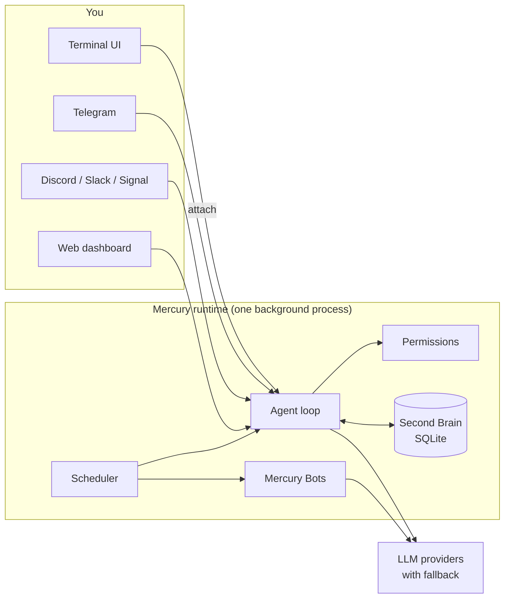

<p align="center">
  <picture>
    <source media="(prefers-color-scheme: dark)" srcset="https://raw.githubusercontent.com/cosmicstack-labs/mercury-agent/main/docs/img/readme-hero-dark.png">
    <source media="(prefers-color-scheme: light)" srcset="https://raw.githubusercontent.com/cosmicstack-labs/mercury-agent/main/docs/img/readme-hero-light.png">
    
  </picture>
</p>

<h3 align="center">The soul-driven AI agent that lives on your machine.<br/>It asks before it acts, remembers what matters, and keeps working when you walk away.</h3>

<p align="center">
  <a href="https://www.npmjs.com/package/@cosmicstack/mercury-agent"></a>
  <a href="https://github.com/cosmicstack-labs/mercury-agent/blob/main/.github/badges/downloads-breakdown.json"></a>
  <a href="https://github.com/cosmicstack-labs/mercury-agent/actions/workflows/ci.yml"></a>
  <a href="https://github.com/cosmicstack-labs/mercury-agent/stargazers"></a>
  <a href="https://nodejs.org/"></a>
  <a href="LICENSE"></a>
  <a href="https://discord.gg/5emMpMJy5J"></a>
</p>

<p align="center">
  <a href="https://trendshift.io/repositories/30943?utm_source=trendshift-badge&amp;utm_medium=badge&amp;utm_campaign=badge-trendshift-30943" target="_blank" rel="noopener noreferrer"></a>
</p>

<p align="center">
  <a href="https://mercuryagent.sh">Website</a> ·
  <a href="https://mercuryagent.sh/docs">Docs</a> ·
  <a href="#quickstart">Quickstart</a> ·
  <a href="CHANGELOG.md">Changelog</a> ·
  <a href="https://discord.gg/5emMpMJy5J">Discord</a> ·
  <a href="README.zh-CN.md">简体中文</a>
</p>

---

**Most AI agents forget you by morning, run whatever the model decides, and stop the moment you close the laptop. Mercury doesn't.**

Mercury is an open-source agent with a personality you write yourself, a memory that stays on your disk, and a permission system that sits between the model and your machine. Message it from your terminal, Telegram, Discord, Slack or Signal and you reach the same agent, with the same memory, running as one background process you own.

It reads and writes your files, runs commands, ships code through git and GitHub, researches the web and keeps a schedule. Every one of those actions is checked against rules you set, and every turn stays inside a daily token budget.

Then it goes further:

- **Mercury Code** turns it into a careful pair programmer inside your repository, one that only says "done" after the tests pass.
- **Mercury Bots** gives it a team. Persistent specialists research, write and ship on their own schedule, then drop finished files in a folder you can open, or straight into your Telegram chat.

Install it in one line. Talk to it from anywhere. It is still there tomorrow, and it still remembers.

## At a glance

| | |
|---|---|
| **Install** | One-line installer with no Node.js required, or `npm i -g @cosmicstack/mercury-agent` on Node.js 22+ |
| **Runs on** | macOS, Linux, Windows, and Android via Termux |
| **Talk to it from** | Terminal UI, Telegram, Discord, Slack, Signal, and a local web dashboard |
| **Models** | DeepSeek, OpenAI, Anthropic, Grok, Ollama (cloud and local), LM Studio, any OpenAI-compatible endpoint, Mercury Cloud, and more, with automatic fallback |
| **Safety** | Shell blocklist, per-folder read/write scopes, approval prompts, SSRF-guarded fetches, secret redaction in logs |
| **Memory** | Second Brain: typed, deduplicated facts in SQLite with full-text search, all on your disk |
| **Tools** | About 50 built in (files, shell, git, GitHub, web, scheduler, memory, sub-agents) plus installable skills |
| **Always on** | Background daemon with crash recovery and a login service on every OS |
| **License** | MIT |

## Why Mercury

Most agents can read files, run commands and fetch pages. The differences are in what happens around those actions, and that is where Mercury puts its effort.

**It asks before it acts.** File access is scoped per folder, shell commands pass through a blocklist and an approval step, and outbound requests are checked against private address ranges. You choose per session whether Mercury asks every time or runs freely, and members of a shared Telegram or Discord channel cannot widen their own access.

**It remembers you without being told to.** After each conversation Mercury extracts a few durable facts (preferences, goals, projects, decisions) with confidence scores, resolves conflicts with what it already knows, and recalls the relevant ones before the next answer. Everything lives in a SQLite file under `~/.mercury`, and `/memory` lets you inspect, pause or clear it.

**It respects a budget.** A daily token budget is enforced on every turn. When usage climbs, Token Saver mode trims context and can route routine work to a cheaper model. `/budget` shows where you stand.

**It is one runtime, not a collection of scripts.** A single background process owns your channels, your bots and the web dashboard. Running `mercury` in a terminal attaches to that process instantly, so closing the terminal never stops a running task or a bot.

**It writes code like a careful engineer.** Mercury Code plans and builds in one flow, shows a live checklist, asks once before large changes, and only reports success after a build, test or typecheck actually passes.

**It works while you are away.** Mercury Bots are persistent specialists with their own persona, model, memory, permissions and daily budget. They run on schedules, hand work to each other, and deliver finished files to `~/Documents/Mercury/<Bot name>/`. You can manage the whole fleet from Telegram with buttons.

**You own the personality.** Mercury's character is defined by plain Markdown files (`soul.md`, `persona.md`, `taste.md`, `heartbeat.md`) that you can edit.

## Quickstart

**1. Install.** The installer downloads a standalone binary for your OS and CPU and verifies its checksum. No Node.js needed.

```bash
# macOS / Linux
curl -fsSL https://mercuryagent.sh/install.sh | sh
```

```powershell
# Windows (PowerShell)
irm https://mercuryagent.sh/install.ps1 | iex
```

Prefer npm? Mercury needs **Node.js 22 or newer** on that path.

```bash
npm i -g @cosmicstack/mercury-agent
```

**2. Run it.**

```bash
mercury
```

The first run starts a short setup wizard: your name, the agent's name, Mercury Cloud or your own API keys, and optional channels such as Telegram. Mercury then starts its background service and opens the terminal UI.

**3. Use it every day.**

```bash
mercury            # open a chat (attaches to the running Mercury)
mercury code .     # open Mercury Code in the current repository
mercury doctor     # change providers, keys or channels; applies immediately
mercury status     # see what is running
```

Upgrades are one command: `mercury upgrade`. It does nothing if you are already on the latest version.

## How it works



The runtime runs as a login service (LaunchAgent on macOS, systemd on Linux, Task Scheduler on Windows) and restarts itself after a crash. Every channel talks to the same agent, the same permissions and the same memory. The terminal is a client: `mercury` attaches to the runtime, and `mercury code` opens a coding session beside it.

## Features

### Channels

| Channel | Access model | Highlights |
|---|---|---|
| **Terminal** | Single user | Full-screen UI with live streaming, a command picker (`/menu`), approval prompts, background tasks |
| **Telegram** | Admins and members, pairing codes | Streaming replies, file delivery, inline buttons for approvals and bot control |
| **Discord** | Admin role, guild and channel scoping | Slash commands, streaming edits, DMs and channels |
| **Slack** | Admins and members | Socket Mode (no public endpoint), streaming edits, `/mercury` command |
| **Signal** | Pairing codes | End-to-end encrypted through `signal-cli`, groups and DMs |
| **Web** | Local login | Chat, Kanban, bots cockpit, memory explorer, providers and skills |

When more than one channel is configured, notifications go to the first available one in order: Signal, Telegram, Discord, Slack, terminal.

### Mercury Code

A full-screen coding environment that works inside a repository.

```bash
mercury code [dir]   # from the shell
/code                # from a running chat
```

- **AUTO mode:** plans and builds in one pass, and asks once before large or risky changes.
- **Verified completion:** a task ends as done only when a build, test or typecheck ran and passed. Otherwise it stops and names the blocker.
- **Live plan:** every step is shown as pending, active or done.
- **Background work:** `/code agent <task>` hands a task to a sub-agent while you keep working.
- **Workspace view:** `/ws` to browse, stage, commit and undo; `/code diff` for a colored diff.

### Mercury Bots

Persistent specialist agents that run next to the main agent without blocking it.

- **Onboard** with `/bots create` from the terminal, Telegram or the web dashboard: persona, permission tier, solo or fleet, daily budget.
- **Fleets:** a lead bot delegates typed tasks to its crew, runs pipelines defined in `bot.yaml`, and gets one summary when the work is done.
- **Deliverables:** finished files land in `~/Documents/Mercury/<Bot name>/`, with work in progress under `work/`. On Telegram, results arrive as attached files.
- **Governed:** per-turn limits, a daily token budget per bot and per fleet, outcomes judged from what the bot actually did, routines that cool down instead of burning tokens.
- **Operate:** `/bots` roster with Stop, Start and Run buttons on Telegram; `/bots cost`, `/bots show`, `/bots doctor`, `/bots stop all`.

Design notes: [BOTS-ARCHITECTURE.md](BOTS-ARCHITECTURE.md).

### Second Brain

- **10 memory types:** identity, preference, goal, project, habit, decision, constraint, relationship, episode, reflection.
- **Automatic extraction** of up to three facts per conversation, with confidence, importance and durability scores.
- **Recall** of the most relevant memories before each answer, within a fixed budget.
- **Consolidation** every hour into a profile and an active-state summary; stale and low-confidence facts age out.
- **Local only:** `~/.mercury/memory/second-brain/second-brain.db` (SQLite with FTS5). Turn it off with `memory.secondBrain.enabled: false`.

### Permissions and safety

- **Shell:** a blocklist that cannot be overridden (`sudo`, `rm -rf /` and its variants), plus approval for everything outside your allowed scopes.
- **Files:** read and write scopes per folder, per channel and per role.
- **Network:** `fetch_url` blocks private address ranges and caps response sizes.
- **Modes:** *Ask Me* or *Allow All* per session, changeable with `/permissions`.
- **Secrets:** API keys live in `~/.mercury/.env`, logs redact them, and the dashboard password is random on first run.

Report a vulnerability through [SECURITY.md](SECURITY.md).

### Skills

Install community skills from [skills.mercuryagent.sh](https://skills.mercuryagent.sh), based on the [Agent Skills](https://agentskills.io) specification.

```bash
mercury skills search prompt
mercury skills view ai-ml/prompt-engineering    # read it before installing
mercury skills install ai-ml/prompt-engineering
```

Skills are community contributed and not audited, so review them first. They can also be installed from the web dashboard or, by admins, from Telegram.

### Web dashboard, Kanban and scheduler

- **Dashboard** at `http://127.0.0.1:6174`, bound to localhost: chat, bots cockpit, memory explorer, providers, skills, permissions, schedules and usage.
- **Kanban boards** that Mercury works through card by card, in dependency order, with per-card token tracking.
- **Scheduler:** cron schedules and one-shot delays through `schedule_task`. Results go back to the channel that created them.

### Providers

Mercury tries your default provider first and falls back to the others if it fails. A provider whose key is rejected is skipped until you fix the key, and `mercury doctor` warns about keys that cannot be valid.

<details>
<summary><b>Supported providers and default models</b></summary>

| Provider | Default model | Key |
|---|---|---|
| Mercury Cloud | `mercury-mini` | paired with `mercury cloud connect` |
| DeepSeek | `deepseek-chat` | `DEEPSEEK_API_KEY` |
| OpenAI | `gpt-4o-mini` | `OPENAI_API_KEY` |
| Anthropic | `claude-sonnet-4` | `ANTHROPIC_API_KEY` |
| Grok (xAI) | `grok-4` | `GROK_API_KEY` |
| Atlas Cloud | `qwen/qwen3.5-flash` | `ATLASCLOUD_API_KEY` |
| Runcrate | `deepseek-ai/DeepSeek-V4.1-Flash` | `RUNCRATE_API_KEY` |
| AI/ML API | `anthropic/claude-sonnet-4.6` | `AIMLAPI_API_KEY` |
| MiMo (Xiaomi) | `mimo-v2.5-pro` | `MIMO_API_KEY` |
| Ollama Cloud | `gpt-oss:120b` | `OLLAMA_CLOUD_API_KEY` |
| Ollama Local | your local model | none |
| LM Studio | your local model | none |
| OpenAI-compatible | any | `OPENAI_COMPAT_API_KEY` and `OPENAI_COMPAT_BASE_URL` |

LiteLLM and GitHub Copilot endpoints are also available through `mercury doctor`.

</details>

## Reference

<details>
<summary><b>CLI commands</b></summary>

| Command | What it does |
|---|---|
| `mercury` | Start Mercury, or attach to it if it is already running |
| `mercury up` | Install the login service and make sure Mercury is running |
| `mercury attach` | Attach this terminal to the running runtime |
| `mercury code [dir]` | Open Mercury Code in a directory |
| `mercury start [-d]` / `stop` / `restart` | Control the runtime |
| `mercury status` / `logs` | Show status and recent logs |
| `mercury doctor [--platform]` | Reconfigure; `--platform` prints a compatibility report |
| `mercury setup` | Run the setup wizard again |
| `mercury upgrade [--force]` | Upgrade to the latest version |
| `mercury telegram` / `discord` / `slack` / `signal` | Manage channel access |
| `mercury bots` | `doctor`, `list`, `storage` |
| `mercury skills` | `search`, `browse`, `view`, `install`, `remove`, `update`, `doctor` |
| `mercury cloud` | `connect`, `disconnect`, `status`, `login`, `models` |
| `mercury service` | `install`, `uninstall`, `status` |
| `mercury web-reset-password` | Reset the dashboard password |
| `mercury uninstall [--purge-data]` | Remove Mercury, optionally with all data |

</details>

<details>
<summary><b>In-chat commands</b></summary>

These run locally and do not use tokens. `/help` lists everything.

| Command | What it does |
|---|---|
| `/menu` | Command picker |
| `/status`, `/trace [id]` | Configuration and usage; what a turn did |
| `/new`, `/sessions` | Fresh conversation; list and switch sessions |
| `/models` | List providers; `/models use <provider>` to switch |
| `/budget`, `/saver` | Token budget; Token Saver mode |
| `/permissions` | Switch between Ask Me and Allow All |
| `/memory` | Inspect and manage the Second Brain |
| `/code`, `/ws` | Mercury Code; workspace view |
| `/research [topic]` | Deep research mode |
| `/bg`, `/agents` | Background tasks; sub-agents |
| `/bots`, `/bot <id> <task>` | Bot fleet; give a bot a task |
| `/tools`, `/skills` | Loaded tools; installed skills |
| `/cloud`, `/spotify` | Mercury Cloud models; Spotify controls |
| `/stop`, `/halt`, `/reset` | Stop work, stop everything, reset context |
| `/whatsnew` | What changed in this version |

</details>

<details>
<summary><b>Built-in tools</b></summary>

| Area | Tools |
|---|---|
| Files | `read_file`, `write_file`, `create_file`, `edit_file`, `list_dir`, `delete_file`, `send_file`, `approve_scope` |
| Shell | `run_command`, `cd`, `approve_command` |
| Git | `git_status`, `git_diff`, `git_log`, `git_add`, `git_commit`, `git_push` |
| GitHub | `create_pr`, `review_pr`, `list_issues`, `create_issue`, `github_api` (when `GITHUB_TOKEN` is set) |
| Web | `fetch_url` |
| Skills | `install_skill`, `list_skills`, `use_skill` |
| Scheduler | `schedule_task`, `list_scheduled_tasks`, `cancel_scheduled_task` |
| Memory | `save_memory`, `search_memory` |
| Agents | `delegate_task`, `list_agents`, `stop_agent`, `dispatch_bot` |
| Interaction | `ask_user`, `update_plan`, `send_message`, `budget_status` |
| Spotify | search, playback, queue, devices, playlists and more (when connected) |

</details>

<details>
<summary><b>Files and configuration</b></summary>

Everything Mercury stores lives in `~/.mercury/`, never in your project.

| Path | Contents |
|---|---|
| `mercury.yaml` | Main configuration: providers, channels, budget, web |
| `.env` | API keys and tokens |
| `soul/*.md` | Personality: soul, persona, taste, heartbeat |
| `permissions.yaml` | Scopes and approval rules |
| `skills/` | Installed skills |
| `schedules.yaml` | Scheduled tasks |
| `sessions/` | Conversations |
| `memory/second-brain/` | Second Brain database |
| `bots/` | Bot personas, journals, queues and permissions |
| `boards.db` | Kanban boards |
| `daemon.log`, `daemon.pid` | Runtime log and process id |

</details>

## Build from source

Requirements: **Node.js 22+**, and [Bun](https://bun.sh) 1.3+ only if you want standalone binaries.

```bash
git clone https://github.com/cosmicstack-labs/mercury-agent.git
cd mercury-agent
npm install
npm run build        # dist/ plus the web UI
npm test             # vitest
node dist/index.js   # run your build
```

Standalone binaries:

```bash
npm run build:bin       # this machine only (release/smoke/)
npm run build:bin:all   # all targets: macOS arm64/x64, Linux x64/arm64 (+ no-AVX2 build), Windows x64 (+ no-AVX2 build)
```

Release binaries are unsigned. On macOS, sign with `codesign` and notarize before distributing your own builds.

## Documentation

| Resource | |
|---|---|
| [mercuryagent.sh/docs](https://mercuryagent.sh/docs) | Guides, platform setup, channel setup, reference |
| [ARCHITECTURE.md](ARCHITECTURE.md) | How the runtime is put together |
| [BOTS-ARCHITECTURE.md](BOTS-ARCHITECTURE.md) | Bots, fleets and their governance |
| [DECISIONS.md](DECISIONS.md) | Architecture decision records |
| [CHANGELOG.md](CHANGELOG.md) | Every release |
| [SECURITY.md](SECURITY.md) | Reporting vulnerabilities |

## Contributing

Contributions are welcome, from bug reports to new tools. Mercury is an agent that runs unattended for days, so a few principles matter more here than in a typical library:

- **Every external action goes through permissions.** Files, shell, network and git never bypass the permission system or the SSRF guard.
- **Assume no human and no terminal.** Tools must behave the same on every channel.
- **Spend tokens carefully.** Keep tool output small; it ends up in the model's context.
- **Fail soft.** A provider outage or a missing file should produce an honest message, not a crash.
- **Test the loop, not only the function.** A tool that works alone can still stall a multi-step turn.

Getting started:

1. Fork and clone the repository, then `npm install`.
2. Make your change with tests next to it.
3. Run `npm run lint`, `npm run typecheck` and `npm test`.
4. Open a pull request that explains what changed and why, one change per PR.

Questions are welcome on [Discord](https://discord.gg/5emMpMJy5J) or at [mercury@cosmicstack.org](mailto:mercury@cosmicstack.org).

## Community

- **Discord:** [discord.gg/5emMpMJy5J](https://discord.gg/5emMpMJy5J) for help, ideas and show-and-tell.
- **Issues:** [GitHub Issues](https://github.com/cosmicstack-labs/mercury-agent/issues) for bugs and feature requests.

## License

[MIT](LICENSE) © [Cosmic Stack](https://github.com/cosmicstack-labs)

Mercury is an AI agent and can make mistakes. Review what it does, especially in *Allow All* mode.
