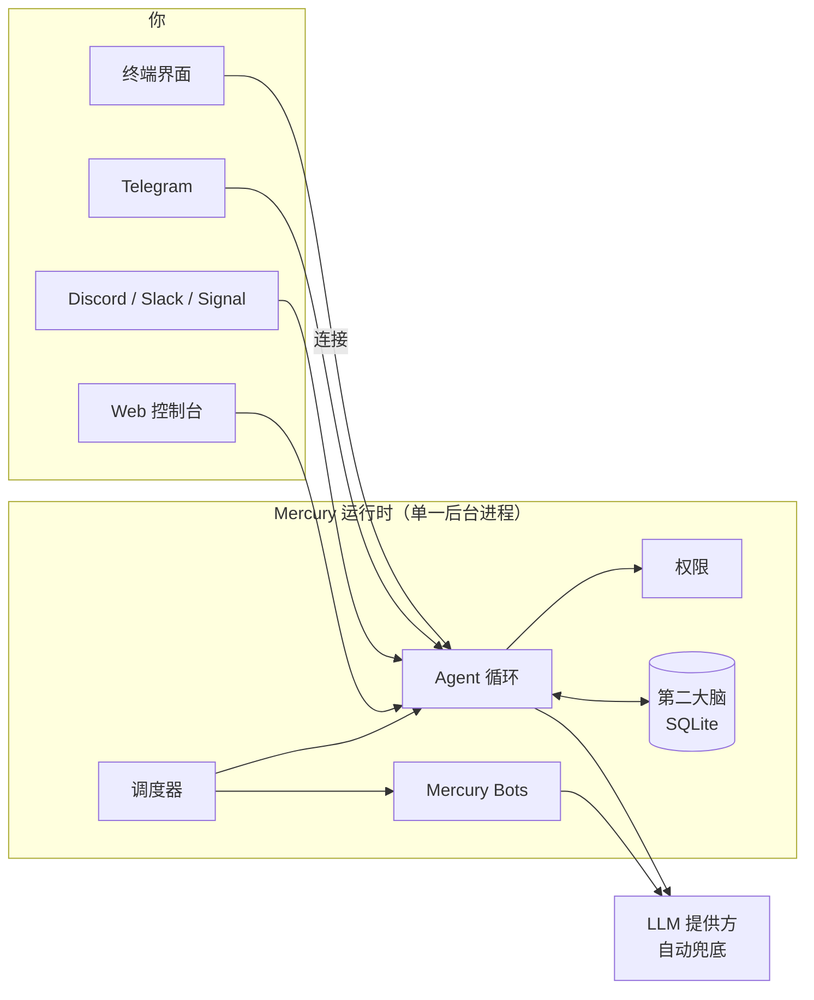

<p align="center">
  <picture>
    <source media="(prefers-color-scheme: dark)" srcset="https://raw.githubusercontent.com/cosmicstack-labs/mercury-agent/main/docs/img/readme-hero-dark.png">
    <source media="(prefers-color-scheme: light)" srcset="https://raw.githubusercontent.com/cosmicstack-labs/mercury-agent/main/docs/img/readme-hero-light.png">
    
  </picture>
</p>

<h3 align="center">以灵魂驱动、运行在你自己机器上的 AI Agent。<br/>行动前先征求同意，记得真正重要的事，你离开后依然在工作。</h3>

<p align="center">
  <a href="https://www.npmjs.com/package/@cosmicstack/mercury-agent"></a>
  <a href="https://github.com/cosmicstack-labs/mercury-agent/blob/main/.github/badges/downloads-breakdown.json"></a>
  <a href="https://github.com/cosmicstack-labs/mercury-agent/actions/workflows/ci.yml"></a>
  <a href="https://github.com/cosmicstack-labs/mercury-agent/stargazers"></a>
  <a href="https://nodejs.org/"></a>
  <a href="LICENSE"></a>
  <a href="https://discord.gg/5emMpMJy5J"></a>
</p>

<p align="center">
  <a href="https://trendshift.io/repositories/30943?utm_source=trendshift-badge&amp;utm_medium=badge&amp;utm_campaign=badge-trendshift-30943" target="_blank" rel="noopener noreferrer"></a>
</p>

<p align="center">
  <a href="https://mercuryagent.sh">官网</a> ·
  <a href="https://mercuryagent.sh/docs">文档</a> ·
  <a href="#快速开始">快速开始</a> ·
  <a href="CHANGELOG.md">更新日志</a> ·
  <a href="https://discord.gg/5emMpMJy5J">Discord</a> ·
  <a href="README.md">English</a>
</p>

---

**大多数 AI Agent 第二天就忘了你，模型说什么就执行什么，合上笔记本就停止工作。Mercury 不会。**

Mercury 是一个开源 Agent：人格由你亲手书写，记忆保存在你自己的磁盘上，模型与你的机器之间隔着一套权限系统。无论你从终端、Telegram、Discord、Slack 还是 Signal 给它发消息，面对的都是同一个 Agent、同一份记忆，运行在一个属于你的后台进程里。

它能读写你的文件、执行命令、通过 git 和 GitHub 交付代码、上网调研、管理日程。每一个动作都会对照你设定的规则检查，每一轮对话都控制在每日 Token 预算之内。

而且不止于此：

- **Mercury Code** 让它成为你代码仓库里一位谨慎的结对程序员，只有测试真正通过后才会说"完成"。
- **Mercury Bots** 给了它一支团队。常驻的专家 Agent 按自己的节奏调研、写作、交付，再把完成的文件放进你能打开的文件夹，或直接发到你的 Telegram。

一行命令安装，随处与它对话。明天它依然在，依然记得你。

## 一览

| | |
|---|---|
| **安装** | 一行命令安装，无需 Node.js；或在 Node.js 22+ 上 `npm i -g @cosmicstack/mercury-agent` |
| **平台** | macOS、Linux、Windows，以及通过 Termux 的 Android |
| **对话入口** | 终端界面、Telegram、Discord、Slack、Signal、本地 Web 控制台 |
| **模型** | DeepSeek、OpenAI、Anthropic、Grok、Ollama（云端与本地）、LM Studio、任何 OpenAI 兼容端点、Mercury Cloud 等，支持自动兜底 |
| **安全** | Shell 黑名单、按文件夹的读写范围、审批提示、带 SSRF 防护的网络请求、日志中的密钥脱敏 |
| **记忆** | 第二大脑：类型化、去重的事实，保存在带全文检索的 SQLite 中，全部在你的磁盘上 |
| **工具** | 约 50 个内置工具（文件、Shell、git、GitHub、网页、调度、记忆、子 Agent），以及可安装的 Skills |
| **常驻运行** | 带崩溃恢复的后台守护进程，各操作系统均有开机自启服务 |
| **许可证** | MIT |

## 为什么选择 Mercury

大多数 Agent 都能读文件、跑命令、抓网页。真正的差别在于这些动作的周围发生了什么，而这正是 Mercury 投入精力的地方。

**行动前先征求同意。** 文件访问按文件夹限定范围，Shell 命令先经过黑名单和审批，对外请求会拦截内网地址。你可以按会话选择每次都询问还是放手执行；共享的 Telegram 或 Discord 频道中的成员无法自行扩大权限。

**不用你开口也能记住你。** 每次对话结束后，Mercury 会提取少量持久的事实（偏好、目标、项目、决定）并附带置信度，与已有记忆进行冲突消解，并在下一次回答前召回相关内容。所有数据都保存在 `~/.mercury` 下的 SQLite 文件里，可以用 `/memory` 查看、暂停或清空。

**遵守预算。** 每一轮对话都执行每日 Token 预算。用量升高时，节省模式会裁剪上下文，并可以把日常任务交给更便宜的模型。`/budget` 显示当前用量。

**一个运行时，而不是一堆脚本。** 由单一的后台进程负责所有渠道、Bots 和 Web 控制台。在终端中运行 `mercury` 会立即连接到这个进程，因此关闭终端不会中断正在执行的任务或 Bot。

**像谨慎的工程师一样写代码。** Mercury Code 在同一流程中完成规划与实现，显示实时清单，在大型改动前询问一次，并且只有在构建、测试或类型检查真正通过后才报告完成。

**你离开时它也在工作。** Mercury Bots 是常驻的专家 Agent，各自拥有人设、模型、记忆、权限和每日预算。它们按计划运行、相互交接任务，并把完成的文件交付到 `~/Documents/Mercury/<Bot 名称>/`。你可以在 Telegram 中通过按钮管理整个 Bot 团队。

**人格由你掌控。** Mercury 的性格由你可以直接编辑的 Markdown 文件定义（`soul.md`、`persona.md`、`taste.md`、`heartbeat.md`）。

## 快速开始

**1. 安装。** 安装脚本会为你的系统和 CPU 下载独立二进制文件并校验其哈希，无需 Node.js。

```bash
# macOS / Linux
curl -fsSL https://mercuryagent.sh/install.sh | sh
```

```powershell
# Windows (PowerShell)
irm https://mercuryagent.sh/install.ps1 | iex
```

更喜欢 npm？这种方式需要 **Node.js 22 或更高版本**。

```bash
npm i -g @cosmicstack/mercury-agent
```

**2. 运行。**

```bash
mercury
```

首次运行会启动一个简短的设置向导：你的名字、Agent 的名字、使用 Mercury Cloud 还是自己的 API Key，以及可选的渠道（例如 Telegram）。之后 Mercury 会启动后台服务并打开终端界面。

**3. 日常使用。**

```bash
mercury            # 打开对话（连接到正在运行的 Mercury）
mercury code .     # 在当前仓库中打开 Mercury Code
mercury doctor     # 修改模型、密钥或渠道，立即生效
mercury status     # 查看运行状态
```

升级只需一条命令：`mercury upgrade`。如果已经是最新版本，它什么也不会做。

## 工作原理



运行时以开机服务的形式运行（macOS 上为 LaunchAgent，Linux 上为 systemd，Windows 上为任务计划程序），崩溃后会自动重启。所有渠道共享同一个 Agent、同一套权限和同一份记忆。终端只是客户端：`mercury` 连接到运行时，`mercury code` 在它旁边打开一个编程会话。

## 功能

### 渠道

| 渠道 | 访问模型 | 亮点 |
|---|---|---|
| **终端** | 单用户 | 实时流式输出的全屏界面、命令选择器（`/menu`）、审批提示、后台任务 |
| **Telegram** | 管理员与成员，配对码 | 流式回复、文件交付、用于审批和 Bot 控制的内联按钮 |
| **Discord** | 管理员角色，按服务器和频道限定 | 斜杠命令、流式编辑、私信与频道 |
| **Slack** | 管理员与成员 | Socket Mode（无需公网地址）、流式编辑、`/mercury` 命令 |
| **Signal** | 配对码 | 通过 `signal-cli` 端到端加密，支持群组和私信 |
| **Web** | 本地登录 | 对话、看板、Bots 控制台、记忆浏览、模型与 Skills 管理 |

配置了多个渠道时，通知按以下顺序发送到第一个可用渠道：Signal、Telegram、Discord、Slack、终端。

### Mercury Code

在代码仓库中工作的全屏编程环境。

```bash
mercury code [dir]   # 在 Shell 中
/code                # 在对话中
```

- **AUTO 模式：** 一次完成规划与实现，在大型或高风险改动前询问一次。
- **经过验证的完成：** 只有构建、测试或类型检查真正运行并通过，任务才会标记为完成；否则会停下并说明阻碍。
- **实时计划：** 每一步都显示为待办、进行中或已完成。
- **后台工作：** `/code agent <任务>` 把任务交给子 Agent，你可以继续工作。
- **工作区视图：** `/ws` 浏览、暂存、提交和撤销；`/code diff` 显示彩色差异。

### Mercury Bots

与主 Agent 并行运行、互不阻塞的常驻专家 Agent。

- **创建：** 在终端、Telegram 或 Web 控制台中使用 `/bots create`：人设、权限级别、单独工作或团队、每日预算。
- **团队：** 主管 Bot 把类型化任务分派给成员，运行在 `bot.yaml` 中定义的流水线，并在工作完成时收到一份汇总。
- **交付物：** 完成的文件放在 `~/Documents/Mercury/<Bot 名称>/`，进行中的工作在 `work/` 下。在 Telegram 中，结果以附件形式送达。
- **受控运行：** 单轮上限、每个 Bot 和每个团队的每日 Token 预算、根据实际行为判定结果、例行任务会冷却而不是持续消耗 Token。
- **运维：** Telegram 中带有停止、启动、运行按钮的 `/bots` 列表；`/bots cost`、`/bots show`、`/bots doctor`、`/bots stop all`。

设计说明：[BOTS-ARCHITECTURE.md](BOTS-ARCHITECTURE.md)。

### 第二大脑

- **10 种记忆类型：** 身份、偏好、目标、项目、习惯、决定、约束、关系、事件、反思。
- **自动提取：** 每次对话最多提取三条事实，附带置信度、重要性和持久度评分。
- **召回：** 每次回答前在固定预算内召回最相关的记忆。
- **整合：** 每小时生成个人画像和当前状态摘要；过期和低置信度的事实会逐步淘汰。
- **仅限本地：** `~/.mercury/memory/second-brain/second-brain.db`（SQLite + FTS5）。可通过 `memory.secondBrain.enabled: false` 关闭。

### 权限与安全

- **Shell：** 不可覆盖的黑名单（`sudo`、`rm -rf /` 及其变体），以及对允许范围之外操作的审批。
- **文件：** 按文件夹、渠道和角色设置读写范围。
- **网络：** `fetch_url` 拦截内网地址并限制响应大小。
- **模式：** 按会话选择 *Ask Me* 或 *Allow All*，可用 `/permissions` 切换。
- **密钥：** API Key 保存在 `~/.mercury/.env`，日志会脱敏，Web 控制台首次运行时生成随机密码。

漏洞报告请参阅 [SECURITY.md](SECURITY.md)。

### Skills

从 [skills.mercuryagent.sh](https://skills.mercuryagent.sh) 安装社区 Skills，遵循 [Agent Skills](https://agentskills.io) 规范。

```bash
mercury skills search prompt
mercury skills view ai-ml/prompt-engineering    # 安装前先阅读
mercury skills install ai-ml/prompt-engineering
```

Skills 由社区贡献且未经审计，请先审阅。也可以在 Web 控制台安装，管理员还可以在 Telegram 中安装。

### Web 控制台、看板与调度

- **控制台** 位于 `http://127.0.0.1:6174`，仅绑定本机：对话、Bots 控制台、记忆浏览、模型、Skills、权限、计划任务和用量。
- **看板：** Mercury 按依赖顺序逐张处理卡片，并记录每张卡片的 Token 用量。
- **调度器：** 通过 `schedule_task` 设置 cron 计划或一次性延时任务，结果发回创建任务的渠道。

### 模型提供方

Mercury 优先使用默认提供方，失败时自动切换到其他提供方。密钥被拒绝的提供方会被跳过，直到你修正密钥；`mercury doctor` 会提示明显无效的密钥。

<details>
<summary><b>支持的提供方与默认模型</b></summary>

| 提供方 | 默认模型 | 密钥 |
|---|---|---|
| Mercury Cloud | `mercury-mini` | 通过 `mercury cloud connect` 配对 |
| DeepSeek | `deepseek-chat` | `DEEPSEEK_API_KEY` |
| OpenAI | `gpt-4o-mini` | `OPENAI_API_KEY` |
| Anthropic | `claude-sonnet-4` | `ANTHROPIC_API_KEY` |
| Grok (xAI) | `grok-4` | `GROK_API_KEY` |
| Atlas Cloud | `qwen/qwen3.5-flash` | `ATLASCLOUD_API_KEY` |
| Runcrate | `deepseek-ai/DeepSeek-V4.1-Flash` | `RUNCRATE_API_KEY` |
| AI/ML API | `anthropic/claude-sonnet-4.6` | `AIMLAPI_API_KEY` |
| MiMo（小米） | `mimo-v2.5-pro` | `MIMO_API_KEY` |
| Ollama Cloud | `gpt-oss:120b` | `OLLAMA_CLOUD_API_KEY` |
| Ollama 本地 | 你的本地模型 | 无需 |
| LM Studio | 你的本地模型 | 无需 |
| OpenAI 兼容 | 任意 | `OPENAI_COMPAT_API_KEY` 与 `OPENAI_COMPAT_BASE_URL` |

LiteLLM 和 GitHub Copilot 端点也可以通过 `mercury doctor` 配置。

</details>

## 参考

<details>
<summary><b>CLI 命令</b></summary>

| 命令 | 作用 |
|---|---|
| `mercury` | 启动 Mercury，若已在运行则连接到它 |
| `mercury up` | 安装开机服务并确保 Mercury 正在运行 |
| `mercury attach` | 将当前终端连接到运行时 |
| `mercury code [dir]` | 在指定目录打开 Mercury Code |
| `mercury start [-d]` / `stop` / `restart` | 控制运行时 |
| `mercury status` / `logs` | 查看状态和最近日志 |
| `mercury doctor [--platform]` | 重新配置；`--platform` 输出兼容性报告 |
| `mercury setup` | 重新运行设置向导 |
| `mercury upgrade [--force]` | 升级到最新版本 |
| `mercury telegram` / `discord` / `slack` / `signal` | 管理渠道访问 |
| `mercury bots` | `doctor`、`list`、`storage` |
| `mercury skills` | `search`、`browse`、`view`、`install`、`remove`、`update`、`doctor` |
| `mercury cloud` | `connect`、`disconnect`、`status`、`login`、`models` |
| `mercury service` | `install`、`uninstall`、`status` |
| `mercury web-reset-password` | 重置控制台密码 |
| `mercury uninstall [--purge-data]` | 卸载 Mercury，可选同时删除全部数据 |

</details>

<details>
<summary><b>对话内命令</b></summary>

这些命令在本地执行，不消耗 Token。`/help` 列出全部命令。

| 命令 | 作用 |
|---|---|
| `/menu` | 命令选择器 |
| `/status`、`/trace [id]` | 配置与用量；某一轮做了什么 |
| `/new`、`/sessions` | 新对话；列出并切换会话 |
| `/models` | 列出提供方；`/models use <provider>` 切换 |
| `/budget`、`/saver` | Token 预算；节省模式 |
| `/permissions` | 在 Ask Me 和 Allow All 之间切换 |
| `/memory` | 查看和管理第二大脑 |
| `/code`、`/ws` | Mercury Code；工作区视图 |
| `/research [topic]` | 深度研究模式 |
| `/bg`、`/agents` | 后台任务；子 Agent |
| `/bots`、`/bot <id> <task>` | Bot 团队；给某个 Bot 分派任务 |
| `/tools`、`/skills` | 已加载工具；已安装 Skills |
| `/cloud`、`/spotify` | Mercury Cloud 模型；Spotify 控制 |
| `/stop`、`/halt`、`/reset` | 停止当前工作、停止全部、重置上下文 |
| `/whatsnew` | 本版本的新内容 |

</details>

<details>
<summary><b>内置工具</b></summary>

| 类别 | 工具 |
|---|---|
| 文件 | `read_file`、`write_file`、`create_file`、`edit_file`、`list_dir`、`delete_file`、`send_file`、`approve_scope` |
| Shell | `run_command`、`cd`、`approve_command` |
| Git | `git_status`、`git_diff`、`git_log`、`git_add`、`git_commit`、`git_push` |
| GitHub | `create_pr`、`review_pr`、`list_issues`、`create_issue`、`github_api`（设置 `GITHUB_TOKEN` 后可用） |
| 网页 | `fetch_url` |
| Skills | `install_skill`、`list_skills`、`use_skill` |
| 调度 | `schedule_task`、`list_scheduled_tasks`、`cancel_scheduled_task` |
| 记忆 | `save_memory`、`search_memory` |
| Agent | `delegate_task`、`list_agents`、`stop_agent`、`dispatch_bot` |
| 交互 | `ask_user`、`update_plan`、`send_message`、`budget_status` |
| Spotify | 搜索、播放、队列、设备、歌单等（连接后可用） |

</details>

<details>
<summary><b>文件与配置</b></summary>

Mercury 存储的所有内容都在 `~/.mercury/` 下，不会写入你的项目目录。

| 路径 | 内容 |
|---|---|
| `mercury.yaml` | 主配置：提供方、渠道、预算、Web |
| `.env` | API Key 和令牌 |
| `soul/*.md` | 人格：soul、persona、taste、heartbeat |
| `permissions.yaml` | 访问范围和审批规则 |
| `skills/` | 已安装的 Skills |
| `schedules.yaml` | 计划任务 |
| `sessions/` | 对话记录 |
| `memory/second-brain/` | 第二大脑数据库 |
| `bots/` | Bot 的人设、日志、队列和权限 |
| `boards.db` | 看板数据 |
| `daemon.log`、`daemon.pid` | 运行时日志和进程 ID |

</details>

## 从源码构建

要求：**Node.js 22+**；如需构建独立二进制文件，还需要 [Bun](https://bun.sh) 1.3+。

```bash
git clone https://github.com/cosmicstack-labs/mercury-agent.git
cd mercury-agent
npm install
npm run build        # 生成 dist/ 和 Web 界面
npm test             # vitest
node dist/index.js   # 运行你的构建
```

独立二进制文件：

```bash
npm run build:bin       # 仅当前机器（release/smoke/）
npm run build:bin:all   # 所有目标：macOS arm64/x64、Linux x64/arm64（含无 AVX2 版本）、Windows x64（含无 AVX2 版本）
```

发布的二进制文件未签名。在 macOS 上分发你自己的构建前，请使用 `codesign` 签名并进行公证。

## 文档

| 资源 | |
|---|---|
| [mercuryagent.sh/docs](https://mercuryagent.sh/docs) | 指南、平台设置、渠道设置、参考 |
| [ARCHITECTURE.zh-CN.md](ARCHITECTURE.zh-CN.md) | 运行时的整体结构 |
| [BOTS-ARCHITECTURE.md](BOTS-ARCHITECTURE.md) | Bots、团队及其治理 |
| [DECISIONS.md](DECISIONS.md) | 架构决策记录 |
| [CHANGELOG.md](CHANGELOG.md) | 每个版本的变更 |
| [SECURITY.md](SECURITY.md) | 漏洞报告 |

## 参与贡献

欢迎各种贡献，从问题报告到新工具。Mercury 是一个会无人值守连续运行多天的 Agent，因此以下原则比普通库更加重要：

- **所有对外动作都经过权限系统。** 文件、Shell、网络和 git 绝不能绕过权限系统或 SSRF 防护。
- **不要假设有人在场或有终端。** 工具在每个渠道上的行为都必须一致。
- **节约 Token。** 保持工具输出精简，它们最终会进入模型上下文。
- **温和失败。** 提供方故障或文件缺失应当给出诚实的提示，而不是崩溃。
- **测试循环，而不只是函数。** 单独可用的工具仍可能卡住多步的一轮对话。

开始贡献：

1. Fork 并克隆仓库，然后执行 `npm install`。
2. 修改代码，并在旁边补充测试。
3. 运行 `npm run lint`、`npm run typecheck` 和 `npm test`。
4. 提交 Pull Request，说明改了什么以及为什么，每个 PR 只做一件事。

欢迎在 [Discord](https://discord.gg/5emMpMJy5J) 或通过 [mercury@cosmicstack.org](mailto:mercury@cosmicstack.org) 提问。

## 社区

- **Discord：** [discord.gg/5emMpMJy5J](https://discord.gg/5emMpMJy5J)，获取帮助、交流想法、展示作品。
- **Issues：** [GitHub Issues](https://github.com/cosmicstack-labs/mercury-agent/issues)，报告问题和提出功能需求。

## 许可证

[MIT](LICENSE) © [Cosmic Stack](https://github.com/cosmicstack-labs)

Mercury 是一个 AI Agent，可能会出错。请检查它的操作，尤其是在 *Allow All* 模式下。
