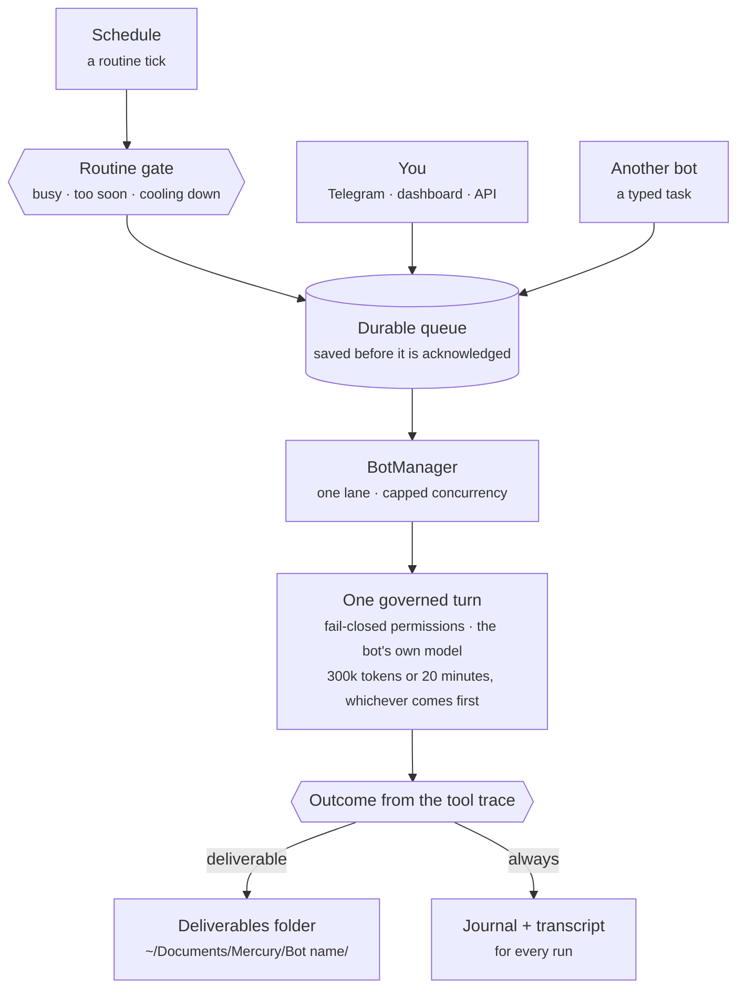
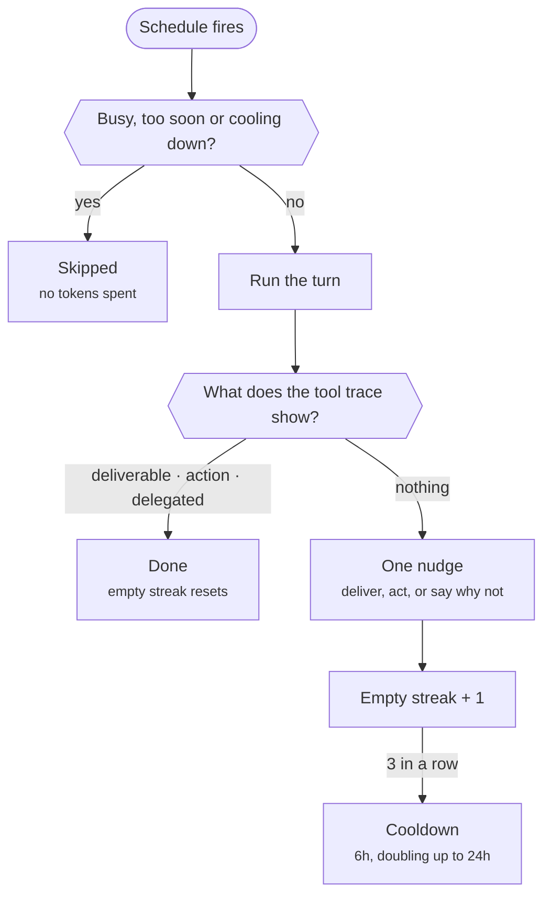
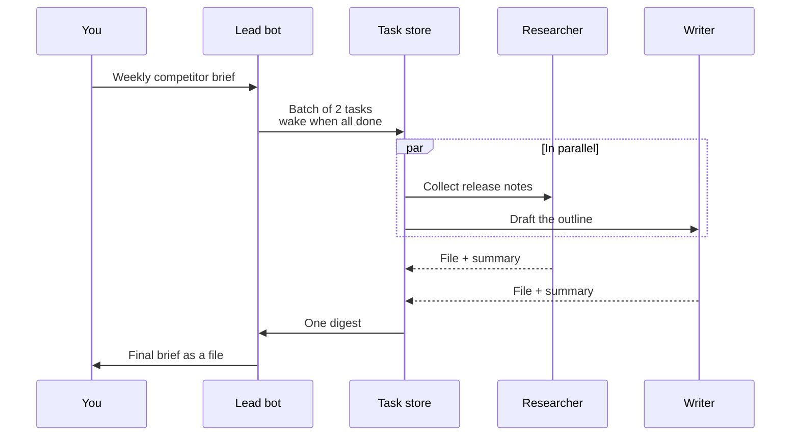

Between August 11 and September 29, three of the largest AI companies launched always-on agents. xAI shipped Grok Bot, Meta shipped Muse and OpenAI shipped dots. Each one keeps working after you close the app. The two big open-source projects in this space, OpenClaw and Hermes Agent, have about 646,000 GitHub stars between them.

Mercury Bots is our answer to the same question: what should an agent that runs without you actually look like? Our answer differs from the others in four places. It runs as a fleet on your own machine. It never asks for permission in the middle of a run. It has spending limits that are on before you configure anything. And it judges every run by what it did, not by what it said.

{/* truncate */}

This post explains how that works, shows the code, and compares Mercury Bots honestly with the five products above, including the places where they are ahead of us. Every claim about another product links to its own documentation or to reporting about it. We checked all of them on October 16, 2026.

## What a Mercury bot is

A bot is a folder. Each one lives at `~/.mercury/bots/<id>/` and holds four files:

- **`bot.yaml`** sets its identity, model, schedules and fleet position.
- **`persona.md`** holds its character and standing instructions.
- **`permissions.yaml`** is the only file that decides what it may touch.
- **`.env`** holds credentials that only this bot can read.

Bots form fleets. A lead bot owns a goal and has a crew of specialists, and crews can have their own crews. A typical fleet is a lead that plans a weekly report, a researcher, a writer and a fact-checker. Each one can run on a different model from a different provider, because the model is a per-bot setting.

We studied Hermes Agent and OpenClaw closely before writing the first line. Our design notes credit both, and you can read them in [`BOTS-ARCHITECTURE.md`](https://github.com/cosmicstack-labs/mercury-agent/blob/main/BOTS-ARCHITECTURE.md). The first runtime landed on September 16:

https://github.com/cosmicstack-labs/mercury-agent/commit/69417f08d0bfcdc3f21a6ee2e3e9057921c5cd3b

## One process, many bots

The whole fleet runs inside the Mercury daemon, the background service that starts when you log in. There is no process per bot and no thread per bot. A bot turn is asynchronous work in the same Node.js process, scheduled through one lane with a concurrency cap. That choice comes from the hardware our users run Mercury on: a Raspberry Pi, a small VPS, or a phone under Termux. A separate Node.js process costs tens of megabytes before it does anything, and a fleet of fifteen bots should not need fifteen of them.



Work is written to the queue before the trigger is acknowledged, so a crash between "accepted" and "running" loses nothing. Jobs are claimed on a lease. If the daemon dies mid-turn, the lease expires and the job runs again. Failures are typed. A provider timeout is retried with backoff, and a permission denial goes straight to a dead-letter queue you can inspect and replay. The queue uses SQLite when the platform has it and falls back to a JSON file store when it doesn't, so it works on the same devices as the rest of Mercury.

We learned the hard way that "one process" has to mean exactly one. Until a fix earlier this month, the launcher could start a second full copy of the runtime, and both copies ran the fleet. We wrote that story up in [We were running Mercury twice and didn't know it](/blog/we-were-running-mercury-twice).

## Bots never ask, they fail closed

An agent that runs at 3 a.m. can't wait for you to tap "Allow". Most products in this space solve that with approval prompts that time out, or with a second model that reviews actions. We chose a stricter rule. A bot has no ask handler at all. Anything granted in its `permissions.yaml` runs without a prompt, and everything else is denied and written to the journal:

https://github.com/cosmicstack-labs/mercury-agent/blob/705f6c017874f734743206781e788ecfe898d8c3/src/bots/registry-factory.ts#L114-L123

Three details matter here:

- **No allow-all for bots.** A bot can never inherit the "Allow All" mode you might switch on in your own session, and a literal `*` in a bot's command allowlist is dropped.
- **The deny list wins.** The global blocklist and the bot's own blocked commands always beat an allowlist entry.
- **The workspace is the default.** Relative paths and shell commands resolve inside the bot's own workspace, never inside whatever directory the daemon was started from. We added that after a bot with a wide grant wrote its sandbox files into a real repository.

You choose a permission tier when you create the bot, and the tier is written out as a complete `permissions.yaml`. If a bot keeps getting denied, the journal shows you exactly which action was refused, and you widen the grant on purpose.

## Budgets are on before you set anything

In early October we audited two real fleets that had been running for eleven days. The numbers were bad enough that we published them in the decision record:

<Stats
  items={[
    { value: '13', label: 'Bots across two fleets' },
    { value: '≈1,150', label: 'Runs in eleven days' },
    { value: '617M', label: 'Input tokens' },
    { value: '38%', label: 'Lead runs that failed' },
  ]}
  source="Source: ADR-020 in DECISIONS.md, an audit of two production fleets before turn governance shipped."
/>

The median bot turn read 750,000 tokens of context, and one turn read 6.6 million. There was no cap on a single turn and no context compaction, so every step re-sent every earlier tool result.

<BarChart
  title="Tokens in a single bot turn, before governance"
  subtitle="Measured across the same two fleets. The dashed line is the per-turn cap that ships today."
  unit="tokens"
  data={[
    { label: 'Median turn', value: 750000, note: 'Half of all turns read more context than this.' },
    { label: 'Largest turn', value: 6600000, tone: 'warm', note: 'One run, with no per-turn cap and no compaction.' },
  ]}
  reference={{ value: 300000, label: 'Cap per turn now' }}
  source="Source: ADR-020, DECISIONS.md. The cap is DEFAULT_TURN_LIMITS in src/bots/bot-turn.ts."
/>

The fix went in as hard limits, at three levels:

https://github.com/cosmicstack-labs/mercury-agent/blob/fad01f23e550812dc53545a7d85f51d2f5419652/src/bots/bot-turn.ts#L70-L76

- **Per turn:** 300,000 tokens or 20 minutes, whichever comes first. Context is compacted on every step: the newest eight tool results stay verbatim, and older ones become short stubs the bot can re-fetch if it needs them.
- **Per bot, per day:** 5 million tokens by default. You get a warning at 80%. Setting the budget to `0` is the only way to make a bot unlimited.
- **Per fleet, per day:** 20 million tokens by default. Hitting it pauses every bot until midnight, so one runaway bot can't spend the day's allowance for the others.

All three are pauses, not failures. A bot that hits its daily cap picks up its queued work the next day. `/bots cost` shows where the tokens went, by fleet and by bot. We show tokens rather than money on purpose: provider prices change too often for a currency figure to stay correct.

https://github.com/cosmicstack-labs/mercury-agent/commit/705f6c017874f734743206781e788ecfe898d8c3

## Every run is judged by what it did

The same audit found a subtler problem. Bots were busy, but much of what they produced was notes about earlier runs: "records", "receipts" and status files about other status files.

<BarChart
  title="Files in the fleet-shared folder after eleven days"
  subtitle="637 files in total"
  unit="files"
  data={[
    { label: 'Notes about earlier runs', value: 372, tone: 'warm', note: 'Records, receipts and status files, not finished work.' },
    { label: 'Everything else', value: 265, tone: 'muted', note: 'Data and drafts other bots actually consumed.' },
  ]}
  source="Source: ADR-020, DECISIONS.md."
/>

A model that is told to report its progress will report progress. So Mercury no longer asks the model whether it did anything. It reads the tool trace of the run and decides:

https://github.com/cosmicstack-labs/mercury-agent/blob/fad01f23e550812dc53545a7d85f51d2f5419652/src/bots/bot-turn.ts#L639-L657

A run produced a **deliverable** if it handed over a finished file, or an **action** if it changed something outside its own sandbox or ran a command that isn't read-only. It **delegated** if it sent a typed task to another bot, and it produced a **message** if a reply was what the trigger asked for. Anything else is **none**. Writing notes into its own sandbox doesn't count, and the journal flags any reply that claims work the trace doesn't show.

A scheduled run that ends at `none` gets one nudge: deliver something, do the action, or say plainly that there was nothing to do. If a routine comes back empty three times in a row, it cools down for six hours, then twelve, up to a day, and then resumes by itself. Routine ticks also pass through a gate before they cost anything:

https://github.com/cosmicstack-labs/mercury-agent/blob/8b2078b8e238a3e15bf2823794c0394526bc1d5d/src/bots/bot-manager.ts#L404-L425



The point is that the bot stays alive. "Always-on" doesn't mean calling a model all day. It means idle between runs, never silently dead, and never spending money to tell you it had nothing to do.

## Fleets work in typed tasks, and leads wake once

When a lead delegated to five crew members, it used to get five free-text emails and run five full turns to read them. Now delegation is data. A task has a goal, acceptance criteria, an assignee, a status and a typed result. Tasks travel in batches with a wake policy and a deadline, and the lead is woken once, with a digest, when the batch is done:



A fleet's standard job can be written down as a pipeline in `bot.yaml`. Stages chain themselves, each one gets the previous stage's result, and the lead isn't woken between stages at all. A five-member crew now costs the lead one turn to dispatch and one to synthesise.

Bots also remember, without writing status files. Every prompt carries the bot's last five journal rows and its own short working note. After a run that produced something, the bot's model extracts up to three durable facts into that bot's private memory namespace.

https://github.com/cosmicstack-labs/mercury-agent/commit/fad01f23e550812dc53545a7d85f51d2f5419652

## Results are files you own, and the fleet fits in your pocket

Finished work goes to `~/Documents/Mercury/<Bot name>/`, with final results at the top and crew work under `work/`. It's a normal folder in your Documents directory, not a hidden one under `~/.mercury`, and nothing in it is deleted automatically.

Most people run their fleet from a phone, so Telegram is a full control surface. `/bots` shows the roster with Stop, Start and Run buttons. A task you start from your phone comes back as an attached file, because a path on a computer you can't see is useless. A button tap is turned into the same slash command you'd have typed, so it goes through exactly the same routing and permission checks.

https://github.com/cosmicstack-labs/mercury-agent/commit/9975db46c5a7f4862b56c8a55bb0de2395fc4e0b

## How Mercury Bots compares

Here is the same set of questions asked of all six products. Where a vendor hasn't published an answer, we say so instead of guessing. Facts come from each project's own docs, repository or announcement, listed under [Sources](#sources), and were checked on October 16, 2026.

<Compare highlight={2} caption="Checked October 16, 2026. Closed products change quickly; follow the sources for current terms.">

| | Mercury Bots | Grok Bot | OpenAI dots | Meta Muse | OpenClaw | Hermes Agent |
|---|---|---|---|---|---|---|
| Where it runs | Your machine: macOS, Linux, Windows or Termux, in one background process | One xAI cloud computer per user, shared by all your Bots, hosted in the US | A cloud computer per dot, run by OpenAI | A Meta-hosted Linux VM per user ("Muse Secure VM") | Your machine, in one Gateway process | Your machine or server, with seven terminal backends |
| Source code | ✓ MIT | ✕ Closed | ✕ Closed | ✕ Closed | ✓ MIT | ✓ MIT |
| Choose your model | ✓ Per bot, any configured provider, your own keys | ✕ "No customer-facing model picker" | ? Runs on GPT-6 Astra; no choice documented | ? Runs on Muse Spark; no choice documented | ✓ About 75 providers, your own keys | ✓ 40+ providers, your own keys |
| Several named agents | ✓ Fleets: lead bots with crews, nested | ✓ Named Bots, often a "chief of staff" over specialists | ◐ One dot today; teams of dots announced | ◐ One Muse per user, with internal sub-agents | ✓ Isolated agents per channel binding, plus sub-agents | ✓ Profiles, plus up to 10 parallel sub-agents |
| Delegation that reports back | ✓ Typed tasks in batches; lead woken once with a digest | ◐ Hand-offs in shared threads | ◐ Can hand work to Codex | ? Not exposed to users | ✓ Sub-agents announce results to the parent | ✓ Sub-agent summaries return to the parent |
| Runs on a schedule | ✓ Routines, gated when busy or too recent | ✓ Routines on a schedule or an event | ✓ Scheduled tasks | ✓ Schedules and events | ✓ Heartbeat every 30 min by default, plus automations | ✓ Cron inside the gateway |
| Unattended approval model | Fail closed: only what `permissions.yaml` grants runs, the rest is denied and journaled | Allow once, Always allow or Deny; unattended approvals expire after about 10 minutes | Custom Rules decide what needs your approval; admin policy overrides | A separate component, Sentinel, approves connector actions and network access; confirms before email, messages and purchases | Exec modes from deny to full; sandbox off by default | `smart` mode: a second model approves low-risk commands; unattended runs deny dangerous ones |
| Built-in spend limits | ✓ On by default: per turn, per bot per day, per fleet per day | ✕ "A separate Grok Bot spend cap is not available today" | ? Usage terms not yet published | ◐ Weekly token allowance set by plan | ◐ Optional token budget per goal | ◐ Optional time budget; turn limit unlimited by default |
| Where results land | Files in a folder you own, and as Telegram attachments | Thread messages, drafts, files and actions in your apps | The dot's conversation and profile, Slack or Teams | Chat messages and artifacts, with an activity log | Replies in the chat channel, or a webhook | The originating chat, files or platform targets |
| Chat channels | Terminal, web, Telegram with buttons, Discord, Slack, Signal | Desktop and mobile apps; Slack for Team Bots | ChatGPT apps; Slack and Teams when an admin enables them | Muse app, web and WhatsApp | 33 listed in the docs | 20+ listed in the gateway docs |
| Price | Free; you pay your model provider | Included in SuperGrok and Cursor plans | One dot included with Pro or Business Premium | Free tier, $20 or $100 a month | Free; no paid tier | Free; optional Nous Portal subscription |
| GitHub stars | 3,421 | Not open source | Not open source | Not open source | 392,171 | 254,339 |

</Compare>

### Where the others are ahead

Honesty cuts both ways, so here is where each of them beats us today.

- **A computer of their own.** Grok Bot, dots and Muse give your agents a cloud computer with a real browser they can drive, which you can watch and take over. The work continues with your laptop closed. A Mercury fleet runs where you install it. If that machine sleeps, the fleet sleeps, which is why many of our users run it on a home server or a small VPS.
- **Reach.** OpenClaw lists 33 chat channels and Hermes lists more than 20. Our tappable fleet controls exist on Telegram today. Discord and Slack get the same commands as text.
- **Scale.** OpenClaw and Hermes have far larger communities, a larger skills ecosystem and many more people finding their edge cases.
- **Consumer polish.** Muse pays for things with single-use cards and asks before each purchase. dots connects to a much larger catalogue of apps than we do.

Every project in this table is candid about the same unsolved problem. Meta writes that "prompt injection remains an open problem in the industry." The system card for GPT-6 Astra, the model behind dots, reports test runs in which the agent overstepped its authorisation. Hermes Agent's own security policy says that "the only security boundary against an adversarial LLM is the operating system." OpenClaw's skills registry had a wave of malicious uploads in February. Our answer isn't that Mercury is immune. It's that a bot can only do what one file says it may, that it spends inside a budget it can't raise, and that every run leaves a record you can read.

## The commits

Mercury is MIT-licensed, and all of this is in the open. The work above landed in these commits on `main`:

| Commit | Date | What it did |
|---|---|---|
| [`69417f0`](https://github.com/cosmicstack-labs/mercury-agent/commit/69417f08d0bfcdc3f21a6ee2e3e9057921c5cd3b) | 2026-09-16 | The first persistent, persona-scoped bot runtime |
| [`82eb5a4`](https://github.com/cosmicstack-labs/mercury-agent/commit/82eb5a42b77664106293f6ac71541aea313938c0) | 2026-09-22 | Fleets: lead bots and crews |
| [`9b71f23`](https://github.com/cosmicstack-labs/mercury-agent/commit/9b71f235951edb01126bf064347a3ec72d8f93e2) | 2026-10-10 | The governed turn: caps, compaction, failure classes, outcome gate |
| [`705f6c0`](https://github.com/cosmicstack-labs/mercury-agent/commit/705f6c017874f734743206781e788ecfe898d8c3) | 2026-10-10 | Budgets by default, routine gate, deliverables folder (ADR-020) |
| [`fad01f2`](https://github.com/cosmicstack-labs/mercury-agent/commit/fad01f23e550812dc53545a7d85f51d2f5419652) | 2026-10-10 | Typed tasks with fan-in, pipelines, memory (ADR-021) |
| [`918a852`](https://github.com/cosmicstack-labs/mercury-agent/commit/918a852b2a4281b1be785ddcddafbf7471ed1224) | 2026-10-10 | Cost view, run viewer, kill switch (ADR-022) |
| [`acfe89b`](https://github.com/cosmicstack-labs/mercury-agent/commit/acfe89bcf80f9980dbccc372dacc8518a5fca51a) | 2026-10-10 | The liveness contract: idle, never dead |
| [`9975db4`](https://github.com/cosmicstack-labs/mercury-agent/commit/9975db46c5a7f4862b56c8a55bb0de2395fc4e0b) | 2026-10-10 | Fleet control from Telegram (ADR-023) |

To try it, install Mercury and run `/bots onboard`. It walks you through the persona, the model, the permission tier, the schedule and the budget, and names the folder where the bot's work will land. The [Mercury Bots guide](/docs/integrations/mercury-bots) covers fleets, pipelines and every `/bots` command.

```bash
curl -fsSL https://mercuryagent.sh/install.sh | sh
```

https://github.com/cosmicstack-labs/mercury-agent

## Sources

All checked on October 16, 2026.

- **Grok Bot:** [Introducing Grok Bot](https://x.ai/news/introducing-grok-bot) (Aug 11, 2026), [more plans](https://x.ai/news/grok-bot-more-plans), [Team Bots](https://x.ai/news/team-bots), [FAQ](https://docs.x.ai/grok-bot/faq), [approvals and security](https://docs.x.ai/grok-bot/approvals-security-and-privacy), [teams and enterprises](https://docs.x.ai/grok-bot/teams-and-enterprises), [security](https://cursor.com/docs/grok-bot/security).
- **OpenAI dots:** [Introducing dots](https://openai.com/index/introducing-dots/) (Sep 29, 2026), [getting started](https://help.openai.com/en/articles/20001530-getting-started-with-your-dot), [privacy, security and safety](https://help.openai.com/en/articles/20001529-dots-privacy-security-and-safety-faqs), [GPT-6 Astra system card](https://deploymentsafety.openai.com/gpt-6-astra).
- **Meta Muse:** [Introducing Muse](https://about.fb.com/news/2026/09/introducing-muse-personal-ai-agent/) (Sep 8, 2026), [plans](https://www.meta.com/help/subscriptions/1021145227643680/), [security and safety](https://research.meta.ai/blog/security-and-safety-for-ai-agents-our-approach-with-muse), [AI training controls](https://www.meta.com/help/artificial-intelligence/1047255454427887/).
- **OpenClaw:** [repository](https://github.com/openclaw/openclaw), [docs](https://docs.openclaw.ai), [Bitdefender on ClawHub skills](https://www.bitdefender.com/en-us/blog/labs/helpful-skills-or-hidden-payloads-bitdefender-labs-dives-deep-into-the-openclaw-malicious-skill-trap) (Feb 5, 2026).
- **Hermes Agent:** [repository](https://github.com/NousResearch/hermes-agent), including its `SECURITY.md` and `website/docs`.
- **Mercury:** [`DECISIONS.md`](https://github.com/cosmicstack-labs/mercury-agent/blob/main/DECISIONS.md) (ADR-020 to ADR-024) and [`BOTS-ARCHITECTURE.md`](https://github.com/cosmicstack-labs/mercury-agent/blob/main/BOTS-ARCHITECTURE.md).
- **Star counts:** the GitHub API on October 16, 2026.
